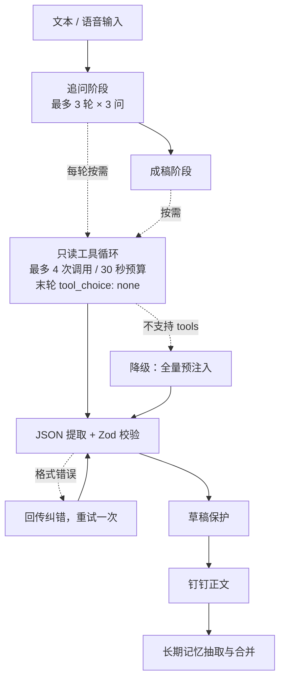

# 学管复盘助手

学管师每天要交固定格式的工作复盘，原始输入通常是「林小满作业写完了，错题讲了两道，跟她妈妈说了下」这类口语流水账，缺主语、缺结果、缺渠道。这个项目把「补全」和「成文」拆成两步：先追问补齐信息，再生成可以直接粘贴到钉钉的结构化正文。

> **演示**：启动项目后访问 `/demo` — 免登录，工作台、历史、学生、记忆、设置五个页面均可操作。数据来自 `lib/demo-data.ts`，刷新后恢复初始状态。

## 一个真实例子

以下取自演示数据（`lib/demo-data.ts`），不是真实学生。

**输入**

> 今天林小满的数学作业写完了，错题讲了两道。她妈妈微信问这周的排课，我说周四晚上有空位。

**追问**

> 林小满妈妈的排课最后确认了吗？ 选项：`已确认周四` / `还在等她回复` / `没有`

**成稿**（模型只返回 `sections`，渲染时自动补栏目符号和序号）

```text
【学情跟进】
林小满：完成今日数学作业，错题已讲解。

【家校沟通】
林小满妈妈（微信）：沟通本周排课，周四晚有空位，已确认。
```

## 工作流程



草稿保护包括：空正文不覆盖当前草稿、漏栏目用当前草稿补回、改文风条目数不一致时保留原稿。

## 核心工程设计

### 两阶段生成

追问阶段只输出问题，不写正文：最多 3 轮、每轮 3 个问题。五个核心栏目（学情跟进、家校沟通、业绩跟踪、日常工作复盘、小橙Ai推进）为空时，本轮问题数没满就必须生成一个带「没有」选项的确认问题；用户确认后保持空数组。成稿阶段才合并流水账与问答，`richang` 恰好 1 条、25-60 字，另外 3 条模板话术只在渲染时追加，不写进 `sections`。

这样避免半成品预览，也避免为最终会被替换的正文付费。改文风是独立模式，以当前草稿为唯一底稿，条目数必须一致。

### 工具循环

学生名单、长期记忆、历史复盘默认不进 prompt，由模型按需调用 `search_students`、`search_memories`、`search_reviews`。循环最多 4 次模型调用：前 3 次允许 `tool_choice: auto`，最后一次强制 `none` 收尾；整体 30 秒预算，单次取 25 秒与剩余预算的较小值。相同参数的查询在一次生成内复用缓存，工具异常转成 `{"error": "..."}` 返回给模型，不打断整次生成。

模型不支持 tools（400/404 且提到 tools）时自动降级为全量预注入，`REVIEW_TOOLS_MODE=off` 可强制关闭。`deepseek-flash` 是思考模式，assistant 消息里的 `reasoning_content` 必须原样回传，否则下一轮直接 400。

### 结构化输出与草稿保护

模型输出先截取 JSON，再过 Zod。格式错误时把错误信息回传给模型，temperature 降到 0.1，只重试一次。最终稿空正文不覆盖当前草稿；漏掉的栏目用当前草稿补回；改文风条目数不一致直接抛错保留原稿。没有配置 Key 或模型持续失败时，按标点拆分原文生成兜底草稿，接口不会 500。

### 长期记忆

复制最终稿时按需抽取记忆：从未提取过，或正文在上次提取后有更新，才调用模型。模型返回 `id` 和新的 `content`；同一件事即使措辞变化，也必须返回旧 `id` 更新，避免「已报名」和「已交费」并存。模型没按 `id` 返回时，用字符二元组 Dice 相似度（同学生、同分类，阈值 0.42）合并。

没有引入向量库：记忆量在几百条以内，这个相似度足够覆盖措辞变化。工具模式下按需查询；降级模式按「通用记忆 + 今天提到的学生」预注入，最多 40 条。

### 语音与移动端

支持 Web Speech API 的浏览器直接用浏览器识别；不支持的环境（安卓微信等）自动切到录音上传，服务端转发 SiliconFlow SenseVoiceSmall 转写，音频不写库。PWA manifest 支持添加到主屏幕。

## 自动化评测

`eval/cases.ts` 有 30 条用例，覆盖短、中、长流水账，空输入，否定回答，多学生，记忆冲突和改文风。

```bash
npm run eval      # 离线：数据集自检、Prompt 组装、模板渲染，不调用模型
npm run eval:ai   # 在线：真实模型生成 + 规则检查，可选 LLM judge
```

| 维度 | 检查内容 | 离线 | 在线 |
| --- | --- | --- | --- |
| 数据集 | 必含事实能在输入里找到，禁止学生不在输入里 | 是 | — |
| Prompt 与模板 | 模式说明、栏目、话术渲染、去重 | 是 | — |
| 结构 | 栏目为数组、无空条目、问题 ≤ 3、notes ≤ 3 | — | 是 |
| 日常工作复盘 | 恰好 1 条，不少于 25 字 | — | 是 |
| 事实 | 必含事实、禁止内容、名单外学生 | — | 是 |
| 栏目覆盖 | 每栏最小/最大条目数 | — | 是 |
| 追问 | 数量、选项、关键词、不泄露内部概念 | — | 是 |
| 工具 | 指定工具必须调用；提到学生必须查记忆 | — | 是 |
| 改文风 | 条目数不变，详细版更长 | — | 是 |
| LLM judge | 事实一致性、完整性、可发送性，各 0-2 分 | — | 可选 |

2026-11-25 全量（`deepseek-flash`，prompt `2026-11-24.2`，含 judge）：29 / 30 通过，平均 5,048 ms，P95 10,446 ms，平均工具调用 1.57 次，50% 的用例发生工具调用，0 次降级。未通过的 medium-002 属栏目覆盖波动，单独复跑 5 / 5 通过。judge 5 条平均：事实一致性 1.0 / 2，完整性 2.0 / 2，可发送性 1.8 / 2。2026-11-24 无 judge 基线为 30 / 30，平均 4,618 ms，P95 7,726 ms。指标定义见 [docs/eval.md](docs/eval.md)。

## 技术栈与快速开始

| 层 | 选型 |
| --- | --- |
| 前端 | Next.js 16 App Router、React 19、TypeScript、Tailwind CSS 4 |
| 后端 | Route Handlers、Zod、OpenAI SDK |
| 数据 | Drizzle ORM；本地 PGlite，生产 Supabase Postgres |
| 模型 | DeepSeek OpenAI 兼容接口，默认 `deepseek-flash` |
| 语音 | Web Speech API + SiliconFlow SenseVoiceSmall |
| 测试与部署 | Vitest、Playwright 验证脚本；腾讯云轻量服务器 + GitHub Actions + Supabase |

```bash
npm install
cp .env.example .env.local   # 至少填 APP_PASSWORD、AUTH_SECRET；按需填 REVIEW_DEEPSEEK_API_KEY
npm run db:migrate
npm run dev
```

本地默认 PGlite，不需要安装数据库。没配 `REVIEW_DEEPSEEK_API_KEY` 也能启动，会按原文拆分生成兜底草稿。打开 `http://localhost:3000`，输入 `APP_PASSWORD` 登录。

## 部署

生产环境部署在腾讯云轻量服务器：Node.js 常驻 + systemd，Nginx/Caddy 反向代理，Supabase 提供 Postgres。

GitHub Actions 的 `Deploy production` 工作流在 `main` 的 CI 通过后自动触发，通过 SSH 执行 `scripts/deploy.sh`：拉取代码 → `npm ci` → `npm run db:migrate` → `npm run build` → 重启 systemd 服务 → 检查 `/login`。仓库 Secrets 需要配置 `SERVER_HOST`、`SERVER_USER`、`SERVER_SSH_KEY`、`SSH_KNOWN_HOSTS`；服务器环境变量按 `.env.example` 配置。HSTS 默认开启，如果由 Nginx/Caddy 统一添加，可设置 `DISABLE_HSTS=1` 关闭应用层重复头。

<details>
<summary>目录结构</summary>

```text
app/              页面与 Route Handlers（含 /demo）
components/       工作台、历史、学生、记忆、设置与基础 UI
lib/ai/           DeepSeek 调用、Prompt、工具循环、记忆抽取
lib/db/           Drizzle schema、连接与查询
lib/eval/         评测规则检查和 judge
eval/             评测数据集与基线
drizzle/          迁移 SQL
scripts/          迁移、评测、统计、UI 验证脚本
tests/            Vitest 单元测试
docs/             架构、评测、部署、FAQ
```

</details>

<details>
<summary>环境变量</summary>

| 变量 | 必填 | 说明 |
| --- | --- | --- |
| `REVIEW_DEEPSEEK_API_KEY` | 否（不填走兜底草稿） | DeepSeek Key，只在服务端读取 |
| `REVIEW_DEEPSEEK_MODEL` | 否 | 默认 `deepseek-flash` |
| `REVIEW_DEEPSEEK_BASE_URL` | 否 | 默认 `https://api.deepseek.com` |
| `REVIEW_TOOLS_MODE` | 否 | `auto`（默认，模型自主查询，失败时降级）或 `off`（强制全量预注入） |
| `REVIEW_ASR_API_KEY` | 否 | SiliconFlow Key，用于录音转写 |
| `REVIEW_ASR_BASE_URL` | 否 | 默认 `https://api.siliconflow.cn/v1` |
| `REVIEW_ASR_MODEL` | 否 | 默认 `FunAudioLLM/SenseVoiceSmall` |
| `APP_PASSWORD` | 是 | 访问密码 |
| `AUTH_SECRET` | 是 | Cookie 签名密钥，至少 32 字节 |
| `DATABASE_URL` | 生产必填 | Supabase 连接串；本地留空用 PGlite |
| `PGLITE_DATA_DIR` | 否 | 本地 PGlite 目录，默认 `.data/pglite` |

部署细节见 `scripts/deploy.sh` 与 `.github/workflows/deploy.yml`。

</details>

<details>
<summary>全部命令</summary>

| 命令 | 作用 |
| --- | --- |
| `npm run dev` | 开发服务器 |
| `npm run build` | 生产构建 |
| `npm run typecheck` | TypeScript 检查 |
| `npm run lint` | ESLint 检查 |
| `npm test` | Vitest 单元测试 |
| `npm run eval` | 离线评测 |
| `npm run eval:ai` | 真实模型评测 |
| `npm run stats` | 使用统计 |
| `npm run db:generate` | 根据 schema 生成迁移 SQL |
| `npm run db:migrate` | 应用迁移 |
| `npm run db:push` | 推送 schema 到数据库（生产不要用） |

</details>

## 隐私与安全

- 学生姓名和家长沟通内容会发送给 DeepSeek API，当前不做脱敏。
- 语音在浏览器内优先使用 Web Speech；录音转写会上传到服务端后转发给 SiliconFlow，不写入数据库。
- DeepSeek Key 只在服务端读取，不会出现在浏览器 bundle。
- 页面使用单密码登录，Cookie 为 HttpOnly + SameSite=Lax，生产环境自动加 Secure。
- 埋点只保存事件名、数量、枚举和耗时，不保存复盘原文、学生姓名或问题内容。
- 仓库中的姓名和内容均为虚构；真实数据保存在私有环境。

## 延伸文档

- [架构说明](docs/architecture.md)：状态机、工具循环、可靠性设计
- [评测说明](docs/eval.md)：数据集、指标定义、历史结果
- [常见问题](docs/faq.md)：配置、部署与使用

## License

[MIT](LICENSE)
