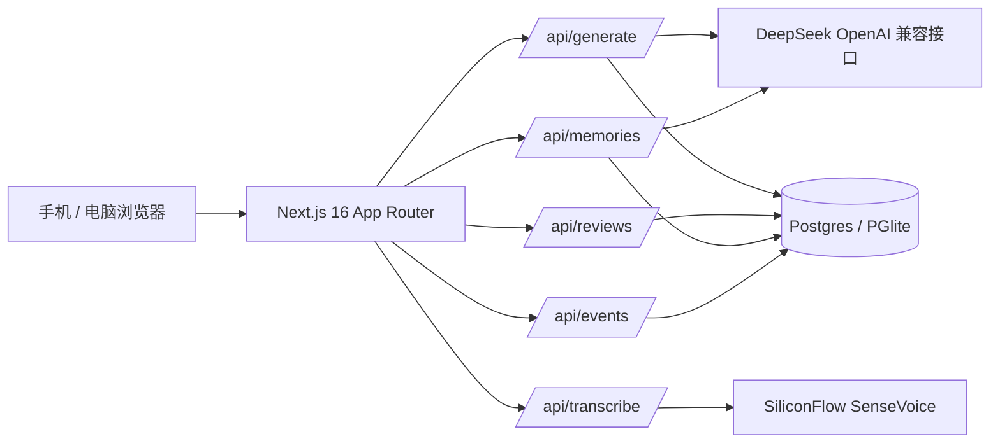

# 学管复盘助手

学管师每天要交固定格式的工作复盘，原始输入通常是「林小满作业写完了，错题讲了两道，跟她妈妈说了下」这类口语流水账，缺主语、缺结果、缺渠道。这个项目把「补全」和「成文」拆成两步：先追问补齐信息，再生成可以直接粘贴到钉钉的结构化正文。

想先看效果可以打开 `/demo`：免登录，五个页面均可操作，数据来自 `lib/demo-data.ts`，刷新后恢复初始状态。

## 功能

| 功能 | 说明 |
| --- | --- |
| 两阶段生成 | 追问阶段只输出问题，最终稿阶段才生成正文 |
| 多轮追问 | 最多 3 轮、每轮最多 3 个问题，支持单选、多选和跳过 |
| 栏目覆盖检查 | 五个核心栏目为空时主动确认，答「没有」就保持空栏 |
| 结构化输出 | JSON 提取 + Zod 校验，格式错误自动纠错重试一次 |
| 失败兜底 | 空正文、漏栏目、AI 不可用时保留原稿或按原文生成草稿；模型不支持工具时自动降级 |
| 学生与长期记忆 | 学生名单管理；从最终复盘抽取记忆，冲突时按相似度合并 |
| 工具查询 | 模型按需调用 `search_students`、`search_memories`、`search_reviews` |
| 话术库 | 【日常工作复盘】固定 1 条当日复盘 + 3 条模板话术；自定义话术润色、查重后加入轮换 |
| 语音与移动端 | 浏览器 Web Speech；不支持的环境改用录音转写；PWA 可添加到主屏幕 |

## 工作流程



流水账 → 追问补全 → 生成最终稿 → 保存复制 → 抽取长期记忆。追问和最终稿共用同一套工具循环，模型按需查询学生、记忆和历史复盘。

改文风是独立模式：以当前草稿为唯一底稿，只改措辞，不增删条目。

## 技术栈

| 层 | 选型 |
| --- | --- |
| 前端 | Next.js 16 App Router、React 19、TypeScript、Tailwind CSS 4 |
| 后端 | Next.js Route Handlers、Zod、OpenAI SDK |
| 数据库 | Drizzle ORM；本地 PGlite，生产 Supabase Postgres |
| 模型 | DeepSeek OpenAI 兼容接口，默认 `deepseek-flash` |
| 语音 | Web Speech API + SiliconFlow SenseVoiceSmall |
| 测试 | Vitest；Playwright UI 验证脚本 |
| 部署 | Vercel + Supabase |

## 实现要点

- 追问阶段只输出 `questions`，用户答完或跳过才调用成文模型。
- 工具循环最多 4 次模型调用、30 秒预算，最后一次强制 `tool_choice: none` 收尾；模型不支持工具调用时退回全量预注入，`REVIEW_TOOLS_MODE=off` 可强制关闭。
- 模型输出先做 JSON 提取和 Zod 校验，格式错误时把错误信息回传重试一次；最终稿空正文不覆盖当前草稿，漏栏目用当前草稿补回，改文风条目数必须一致。
- 学生名单、长期记忆和历史复盘由模型通过三个只读工具按需查询；参数用 Zod 校验，同一次生成内相同查询复用缓存。
- 记忆抽取优先按 `id` 更新，没有 id 时用字符二元组 Dice 相似度合并。
- 本地默认 PGlite，生产配置 `DATABASE_URL` 后使用 Supabase Postgres，迁移统一走 Drizzle SQL。

## 快速开始

```bash
npm install
cp .env.example .env.local
```

至少填写：

```env
REVIEW_DEEPSEEK_API_KEY=你的 DeepSeek Key
APP_PASSWORD=访问密码
AUTH_SECRET=随机长字符串
```

初始化数据库并启动：

```bash
npm run db:migrate
npm run dev
```

打开 `http://localhost:3000`，输入 `APP_PASSWORD` 登录。

没有配置 `REVIEW_DEEPSEEK_API_KEY` 时应用仍可启动，会按原文拆分生成兜底草稿，并提示 AI 未连接。

## 常用命令

| 命令 | 作用 |
| --- | --- |
| `npm run dev` | 开发服务器 |
| `npm run build` | 生产构建 |
| `npm run typecheck` | TypeScript 检查 |
| `npm run lint` | ESLint 检查 |
| `npm test` | Vitest 单元测试 |
| `npm run eval` | 离线评测 |
| `npm run eval:ai` | 真实模型评测 |
| `npm run stats` | 使用统计 |
| `npm run db:generate` | 根据 schema 生成迁移 SQL |
| `npm run db:migrate` | 应用迁移 |

## 评测

`eval/cases.ts` 有 30 条用例，覆盖短、中、长流水账，空输入，否定回答，多学生，记忆冲突和改文风等场景。

```bash
npm run eval      # 离线检查：数据集、Prompt 组装、模板，不需要 Key
npm run eval:ai   # 真实模型评测，需要 REVIEW_DEEPSEEK_API_KEY
```

指标定义和历史结果见 [docs/eval.md](docs/eval.md)。

## 目录结构

```text
app/             页面与 Route Handlers
components/      工作台、历史、学生、记忆、设置、演示页与基础 UI
lib/ai/          DeepSeek 调用、Prompt、工具循环、记忆抽取
lib/db/          Drizzle schema、连接与查询
lib/eval/        评测规则检查和 judge
eval/            评测数据集
drizzle/         迁移 SQL
scripts/         迁移、评测、统计、UI 验证脚本
tests/           Vitest 单元测试
docs/            架构、评测、部署、FAQ
```

## 隐私与安全

- 学生姓名和家长沟通内容会发送给 DeepSeek API，当前不做脱敏。
- 语音在浏览器内优先使用 Web Speech；录音转写会上传到服务端后转发给 SiliconFlow，不写入数据库。
- DeepSeek Key 只在服务端读取，不会出现在浏览器 bundle。
- 页面使用单密码登录，Cookie 为 HttpOnly + SameSite=Lax，生产环境自动加 Secure。
- 埋点只保存事件名、数量、枚举和耗时，不保存复盘原文、学生姓名或问题内容。
- 仓库中的姓名和内容均为虚构；真实数据保存在私有环境。

## License

[MIT](LICENSE)
