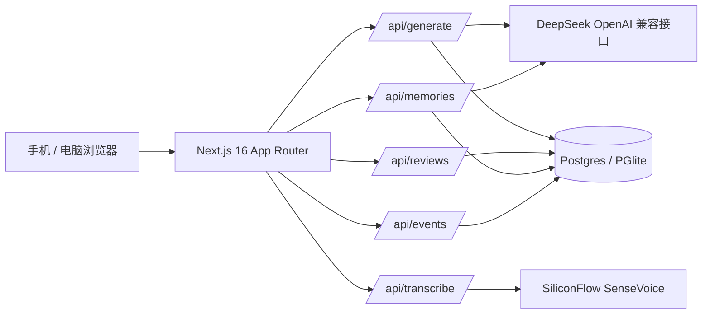

# 学管复盘助手

把学管师每天零散、口语化的工作流水账，经过多轮追问补全，整理成可以直接复制到钉钉工作群的规范复盘。

已在真实学管场景持续使用，支持手机和电脑，核心链路为：**流水账 → 追问补全 → 结构化正文 → 编辑 → 复制 → 长期记忆**。

> 想先看效果可以打开 `/demo`：免登录，包含今日复盘、历史、记忆、学生、设置五个页面。数据全部预置，不读数据库、不调用模型，刷新后恢复初始状态。

## 背景

学管师每天要发固定格式的工作复盘。原始输入通常是「林小满作业写完了，错题讲了两道，跟她妈妈说了下」这类口语流水账，信息缺主语、缺结果、缺渠道。直接把原文丢给大模型，常见问题是：

- 编造没发生的沟通、金额或学生；
- 把空栏目硬凑上内容；
- 输出带 Markdown，粘贴到钉钉还要手工清理；
- 一次生成几千 token，结果还不能直接用。

这个项目把「补全」和「成文」拆成两个阶段：先用多轮问题补齐信息缺口，再生成结构化正文。用户答完或跳过后才调用成文模型，避免半成品预览和无效 token。

## 核心能力

| 能力 | 说明 |
| --- | --- |
| 两阶段生成 | 追问阶段只输出问题，最终稿阶段才生成正文 |
| 多轮追问 | 最多 3 轮、每轮最多 3 个问题，支持单选/多选/跳过 |
| 栏目覆盖检查 | 五个核心栏目为空时主动确认，答「没有」就保持空栏 |
| 结构化输出 | JSON Schema + Zod 校验，格式错误自动纠错重试一次 |
| 失败兜底 | 空正文、漏栏目、AI 不可用时保留原稿或按原文生成草稿；模型不支持工具时自动降级 |
| 长期记忆 | 从最终复盘里抽取学生/通用记忆，冲突时按相似度合并 |
| 工具调用 | 模型按需调用 `search_students` / `search_memories` / `search_reviews`，不再全量预注入 |
| 历史参考 | 模型可按关键词或日期查历史复盘，不再写死最近两天 |
| 通用话术 | 【日常工作复盘】固定 1 条当日复盘 + 3 条模板话术，按当天主题和日期轮换 |
| 语音输入 | 浏览器 Web Speech；不支持的环境改用录音转写 |
| 移动端 | PWA，可添加到主屏幕，安卓微信可用录音转写 |
| 游客演示 | `/demo` 五个页面全部可操作，数据在内存里，不读库、不调模型 |

## 架构



生成链路：

```text
流水账 + 已问答 + 当前草稿
        │
        ▼
  工具循环（最多 4 次模型调用）
        │  模型自主决定是否调用
        │  search_students / search_memories / search_reviews
        ▼
  追问阶段（questions）── 只输出问题，不生成正文
        │  用户回答 / 跳过
        ▼
  最终稿阶段（final）── 同一个工具循环，生成结构化 sections
        │
        ▼
  normalizeDraft → Zod 校验 → 漏栏目保护
        │
        ▼
  保存 → 渲染纯文本 → 复制到钉钉 → 抽取长期记忆
```

改文风是独立模式：以当前草稿为唯一底稿，只改措辞，不增删条目。

## 技术栈

| 层 | 选型 |
| --- | --- |
| 前端 | Next.js 16 App Router、React 19、TypeScript、Tailwind CSS 4 |
| 后端 | Next.js Route Handlers、Zod、OpenAI SDK |
| 数据库 | Drizzle ORM；本地 PGlite，生产 Supabase Postgres |
| 模型 | DeepSeek OpenAI 兼容接口，默认 `deepseek-flash` |
| 语音 | Web Speech API + SiliconFlow SenseVoiceSmall |
| 测试 | Vitest；Playwright 可选 UI 测试 |
| 部署 | Vercel + Supabase |

## 技术亮点

**1. 先追问、后成文**
追问阶段只生成 `questions`，不生成 `sections`。用户回答完或跳过后才进入最终稿，避免展示半成品，也避免为最终会被替换的正文付费。

**2. 结构化输出的多层保护**
模型输出先经过 JSON 提取和 Zod 校验；格式错误时把错误信息回传给模型重试一次。最终稿还会检查：

- 空正文不覆盖当前草稿；
- 漏掉的栏目用当前草稿补回；
- 改文风时条目数必须一致；
- 没有配置 Key 时按原文拆分兜底，页面不崩。

**3. 长期记忆的冲突处理**
记忆抽取使用独立 prompt，返回 `id` 表示更新已有记忆。模型没有按 id 更新时，用字符二元组 Dice 相似度兜底合并，避免「报名」「已报名」「已交费」越记越多、状态互相矛盾。

**4. 工具调用：数据由模型按需查询**
学生名单、长期记忆和历史复盘不再每次整块塞进 prompt，模型根据流水账自行决定查谁、查多远。

- 三个只读工具，参数用 Zod 校验，返回结果做条数和长度截断；
- 同一次生成内相同查询复用缓存，避免把同一个学生查两遍；
- 最多 4 次模型调用，最后一次强制 `tool_choice: none` 收尾，工具循环预算 30 秒；
- 模型不支持工具调用时自动退回全量预注入，`REVIEW_TOOLS_MODE=off` 可强制关闭。

**5. 本地零依赖，生产可迁移**
本地默认使用 PGlite，不需要安装数据库；生产配置 `DATABASE_URL` 后自动切换 Supabase/Postgres。迁移统一走 Drizzle SQL，生产禁用 `db:push`。

**6. 埋点不碰内容**
`usage_events` 只记录事件名、数量、枚举和耗时，不记录复盘原文、学生姓名或问题内容。统计脚本输出生成成功率、P95 延迟、token、复制率、编辑改动等指标。

## 评测与指标

`eval/cases.ts` 包含 30 条用例，覆盖短/中/长流水账、空输入、否定回答、多学生、记忆冲突、改文风等场景。规则检查包括结构、必含事实、禁止内容、栏目覆盖、追问质量和文风约束；可选 LLM judge 做辅助打分。

最近一次 `npm run eval:ai`（2026-11-18，`deepseek-flash`）：

| 指标 | 结果 |
| --- | --- |
| 用例通过 | 30 / 30 |
| 平均耗时 | 3.7 s |
| P95 耗时 | 7.0 s |
| 平均 prompt tokens | 3,566 |
| 平均 completion tokens | 534 |
| 平均工具调用 | 1.53 次 |
| 发生过工具调用的用例 | 50% |

> 工具模式下 prompt tokens 是同一用例多轮请求的累计值，和单次预注入不是同一口径。

```bash
npm run eval      # 离线检查：数据集、Prompt 组装、模板，不需要 Key
npm run eval:ai   # 真实模型评测，需要 REVIEW_DEEPSEEK_API_KEY
npm run eval:ai -- --judge --judge-limit=5
npm run stats -- --days=30
```

> 这些数字来自当前数据集和模型版本，不是通用 benchmark。换模型或改 prompt 后应重跑，并用 `--baseline` 对比。

## 快速开始

```bash
npm install
cp .env.example .env.local
```

至少填写：

```env
REVIEW_DEEPSEEK_API_KEY=你的 DeepSeek Key
APP_PASSWORD=访问密码
AUTH_SECRET=随机长字符串
```

初始化数据库并启动：

```bash
npm run db:migrate
npm run dev
```

打开 `http://localhost:3000`，输入 `APP_PASSWORD` 登录。

没有配置 `REVIEW_DEEPSEEK_API_KEY` 时，应用仍可启动：会按原文拆分生成兜底草稿，并提示 AI 未连接。

## 常用命令

| 命令 | 作用 |
| --- | --- |
| `npm run dev` | 开发服务器 |
| `npm run build` | 生产构建 |
| `npm run typecheck` | TypeScript 检查 |
| `npm test` | Vitest 单元测试 |
| `npm run eval` | 离线评测 |
| `npm run eval:ai` | 真实模型评测 |
| `npm run stats` | 使用统计 |
| `npm run db:generate` | 根据 schema 生成迁移 SQL |
| `npm run db:migrate` | 应用迁移 |

生产部署、Supabase 配置和常见问题见 [docs/deploy.md](docs/deploy.md) 与 [docs/faq.md](docs/faq.md)。

## 目录结构

```text
app/
  (app)/            登录后的页面：工作台、历史、学生、记忆、设置
  api/              登录、生成、保存、学生、设置、记忆、埋点接口
components/
  demo/             游客演示页
  workspace/        工作台交互
  students/         学生管理
  history/          历史列表
  settings/         设置
  ui/               基础 UI 组件
lib/
  ai/               DeepSeek 调用、Prompt、工具循环、记忆抽取
  analytics/        事件记录与统计
  db/               Drizzle schema、连接、查询
  eval/             规则检查和 judge
  auth*.ts          登录态
  template.ts       最终复盘渲染
  schema.ts         Zod 校验
  draft.ts          草稿清洗与兜底
eval/               评测数据集
drizzle/            迁移 SQL
scripts/            迁移、评测、统计、UI 测试
tests/              Vitest 单元测试
docs/               架构、评测、部署、FAQ
```

## 隐私与安全

- 学生姓名、家长沟通内容会发送给 DeepSeek API；当前版本按用户选择不做脱敏。
- 电脑端语音使用浏览器 Web Speech API；录音转写会把音频上传到本项目服务端，再转发给 SiliconFlow，不写入数据库。
- DeepSeek Key 只在服务端读取，不会出现在浏览器 bundle。
- 页面使用单密码登录，Cookie 为 HttpOnly + SameSite=Lax，生产环境自动加 Secure。
- 埋点表只保存数量和枚举，不保存原文、姓名或问题内容。
- 公开仓库使用虚拟姓名和假数据；真实数据保存在私有环境。
- `/demo` 页面的姓名和内容写死在 `lib/demo-data.ts`，不读数据库，也不发起任何请求。

## Roadmap

- 向量检索：用 embedding 替代记忆的字符串匹配；
- 流式输出：降低长文本等待感；
- 质量反馈：生成结果增加 👍/👎，形成真实 bad case 池；
- 可观测性：接入 Langfuse，补齐 trace 和成本看板。

## License

[MIT](LICENSE)
